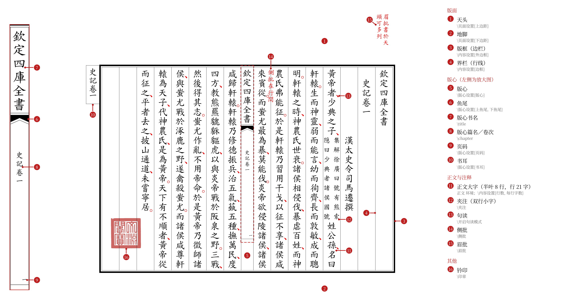

[English Version](EN:Anatomy) | 中文版

# 古籍版式要素

不熟悉古籍版式的读者，可以先在这一页对照：图上每个编号是一种版式要素，下表给出它的标准名称、luatex-cn 里对应的命令或参数，以及详细说明所在的页面。

> 图为一整版（左右两个半叶连同中间的版心），用 `\documentclass[四库全书]{ltc-guji}` 排出，加 `\关闭分页` 不拆成两页。左侧是版心的放大图。
> 底稿与生成脚本见仓库 [`资源/wiki-figures/anatomy/`](https://github.com/open-guji/luatex-cn/tree/main/资源/wiki-figures/anatomy)。

## 名称对照表

| 编号 | 古籍要素 | 含义 | luatex-cn 对应 | 详见 |
|------|----------|------|----------------|------|
| 1 | 天头 | 版框上方的空白 | `\页面设置{上边距}` | [[命令索引 \| Command-Reference]] |
| 2 | 地脚 | 版框下方的空白 | `\页面设置{下边距}` | [[命令索引 \| Command-Reference]] |
| 3 | 版框（边栏） | 围住整版的外框；四周双边即内外两道线 | `\内容设置{外边框, 外边框粗细, 外边框间距}` | [[模板与自定义 \| Templates]] |
| 4 | 界栏（行线） | 行与行之间的竖线 | `\内容设置{边框, 边框粗细, 边框色}` | [[模板与自定义 \| Templates]] |
| 5 | 版心 | 一版正中、折叠处的窄行 | `\版心设置{版心}`；宽度 `\内容设置{版心比例}` | [[功能详解 \| Features]] |
| 6 | 鱼尾 | 版心中的分界符号 | `\版心设置{上鱼尾, 下鱼尾}` | [[功能详解 \| Features]] |
| 7 | 版心书名 | 刻在版心上部的书名 | `\title{...}` | [[功能详解 \| Features]] |
| 8 | 版心篇名／卷次 | 刻在版心中部的篇名或卷次 | `\chapter{...}` | [[功能详解 \| Features]] |
| 9 | 页码 | 刻在版心下部的叶次 | `\版心设置{页码={...}}` | [[命令索引 \| Command-Reference]] |
| 10 | 书耳 | 边栏外上角记篇名的小框 | `\版心设置{书耳}`（v0.4.4 之后的新版本） | — |
| 11 | 正文大字、行款 | 正文；「半叶 8 行，行 21 字」这类规格叫行款 | `正文` 环境；`\内容设置{行数, 每行字数}` | [[模板与自定义 \| Templates]] |
| 12 | 夹注（双行小字） | 夹在正文中的双行小字注 | `\夹注{...}`、`\单行夹注{...}` | [[夹注与侧批 \| Side-Note]] |
| 13 | 句读 | 字旁的断句圈点 | `\开启句读模式`、`\句读设置` | [[句读 \| Judou]] |
| 14 | 侧批 | 写在行间的批语 | `\侧批{...}` | [[夹注与侧批 \| Side-Note]] |
| 15 | 眉批 | 写在天头的批语 | `\眉批{...}`；任意位置用 `\批注` | [[批注与眉批 \| Annotation]] |
| 16 | 钤印 | 藏书印等印章 | `\印章[...]{图片}` | [[印章 \| Seal]] |

图里没有画出、但同样常用的要素：

| 古籍要素 | luatex-cn 对应 | 详见 |
|----------|----------------|------|
| 抬头（敬称另起一行并高出） | `\抬头`、`\平抬`、`\单抬`、`\双抬`、`\挪抬` | [[抬头 \| Taitou]] |
| 牌记（刊刻者、刊刻时地的题记） | `\牌记{...}` | [[文本框 \| Textbox]] |
| 筒子页（一版对折成前后两个半叶） | 默认开启；`\关闭分页` 关闭 | [[命令索引 \| Command-Reference]] |

> 象鼻（版心上下端到鱼尾之间）的黑口、花鱼尾等变化，目前还没有专门参数。

## 延伸阅读

- 维基百科：[线装书](https://zh.wikipedia.org/wiki/線裝書)
