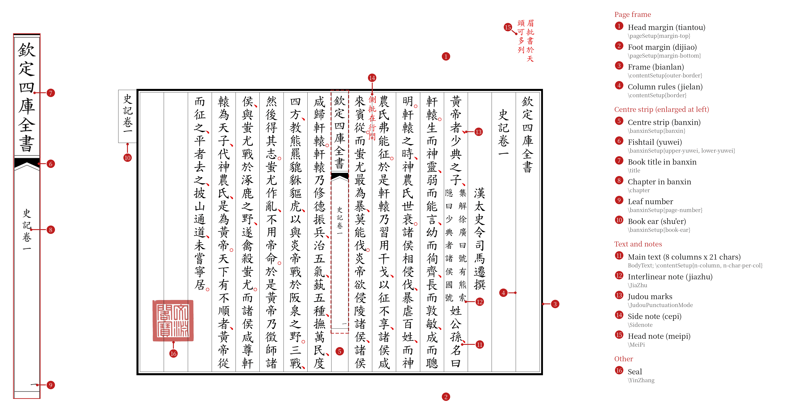

English | [中文版](Anatomy)

# Anatomy of a Traditional Chinese Book Page

If you are new to traditional Chinese book layout, start here. Each number in the figure marks one element of the page; the table below gives its standard Chinese name, the luatex-cn command or option that controls it, and the page with the details.

> The figure is one whole printing block (two half leaves plus the centre strip between them), typeset with `\documentclass[四库全书]{ltc-guji}` and `\关闭分页` so it is not split into two pages. The centre strip is enlarged at the left.
> The source and the script that draws the figure are in [`资源/wiki-figures/anatomy/`](https://github.com/open-guji/luatex-cn/tree/main/资源/wiki-figures/anatomy).

## Name Table

| No. | Element | Meaning | luatex-cn | Details |
|-----|---------|---------|-----------|---------|
| 1 | 天头 tiantou (head margin) | Blank space above the frame | `\pageSetup{margin-top}` | [[Command Reference \| Command-Reference]] |
| 2 | 地脚 dijiao (foot margin) | Blank space below the frame | `\pageSetup{margin-bottom}` | [[Command Reference \| Command-Reference]] |
| 3 | 版框 / 边栏 bianlan (frame) | Outer frame around the block; "double border" means two lines | `\contentSetup{outer-border, outer-border-thickness, outer-border-sep}` | [[Templates \| EN:Templates]] |
| 4 | 界栏 jielan (column rules) | Vertical lines between columns | `\contentSetup{border, border-thickness, border-color}` | [[Templates \| EN:Templates]] |
| 5 | 版心 banxin (centre strip) | Narrow column in the middle, where the leaf is folded | `\banxinSetup{banxin}`; width: `\contentSetup{banxin-ratio}` | [[Features \| EN:Features]] |
| 6 | 鱼尾 yuwei (fishtail) | Dividing marks in the centre strip | `\banxinSetup{upper-yuwei, lower-yuwei}` | [[Features \| EN:Features]] |
| 7 | 版心书名 | Book title in the upper centre strip | `\title{...}` | [[Features \| EN:Features]] |
| 8 | 版心篇名 / 卷次 | Chapter or volume in the middle of the strip | `\chapter{...}` | [[Features \| EN:Features]] |
| 9 | 页码 | Leaf number in the lower strip | `\banxinSetup{page-number={...}}` | [[Command Reference \| Command-Reference]] |
| 10 | 书耳 shu'er (book ear) | Small box outside the top corner of the frame, holding the chapter name | `\banxinSetup{book-ear}` (releases after v0.4.4) | — |
| 11 | 正文 main text; 行款 format | Main text; a format such as "8 columns of 21 characters per half leaf" | `BodyText` (`正文`) environment; `\contentSetup{n-column, n-char-per-col}` | [[Templates \| EN:Templates]] |
| 12 | 夹注 jiazhu (interlinear note) | Two-column small-print note inside the text | `\JiaZhu{...}` (`\夹注`), `\单行夹注{...}` | [[Side Note \| EN:Side-Note]] |
| 13 | 句读 judou | Punctuation marks beside the characters | `\JudouPunctuationMode` (`\开启句读模式`), `\judouSetup` | [[Judou \| EN:Judou]] |
| 14 | 侧批 cepi (side note) | Comment written between columns | `\Sidenote{...}` (`\侧批`) | [[Side Note \| EN:Side-Note]] |
| 15 | 眉批 meipi (head note) | Comment written in the head margin | `\MeiPi{...}` (`\眉批`); anywhere: `\PiZhu` (`\批注`) | [[Annotation \| EN:Annotation]] |
| 16 | 钤印 seal | Collector's seals and stamps | `\YinZhang[...]{image}` (`\印章`) | [[Seal \| EN:Seal]] |

Common elements not shown in the figure:

| Element | luatex-cn | Details |
|---------|-----------|---------|
| 抬头 taitou (elevation of honorifics) | `\TaiTou` (`\抬头`), `\平抬`, `\单抬`, `\双抬`, `\NuoTai` (`\挪抬`) | [[Elevation \| EN:Taitou]] |
| 牌记 colophon | `\colophon{...}` (`\牌记`) | [[Textbox \| EN:Textbox]] |
| 筒子页 folded leaf (one block printed as two half leaves) | On by default; `\关闭分页` turns it off | [[Command Reference \| Command-Reference]] |

> Variants such as a black mouth (黑口) in the elephant trunk (象鼻) or decorated fishtails do not have dedicated options yet.

## Further Reading

- Wikipedia: [Thread binding (線裝書, Chinese)](https://zh.wikipedia.org/wiki/線裝書)
