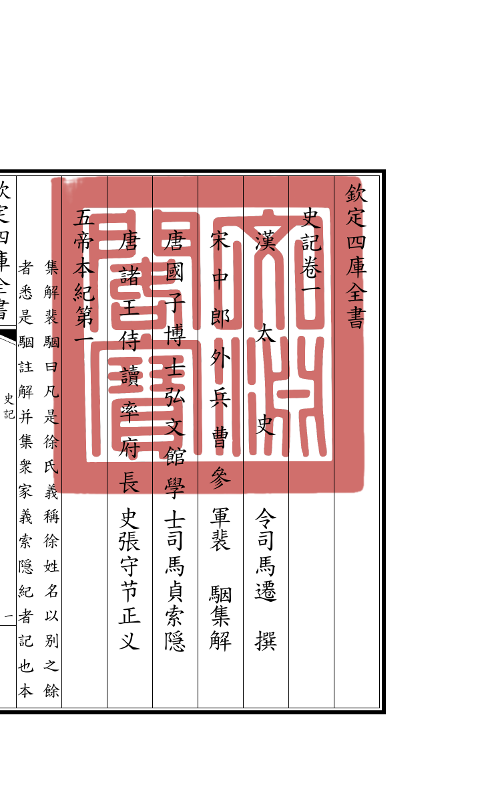
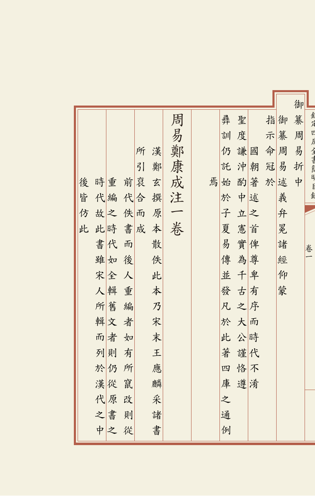
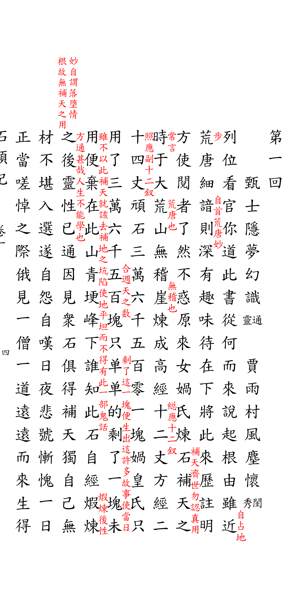
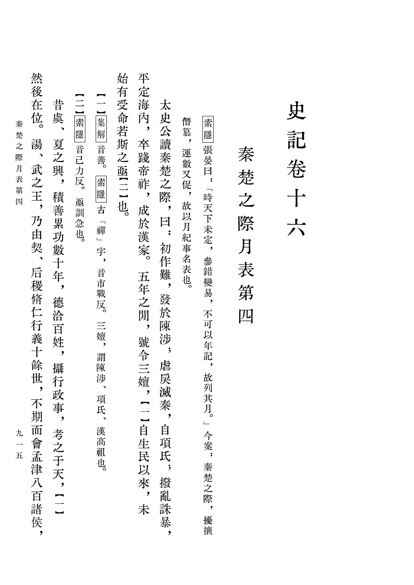
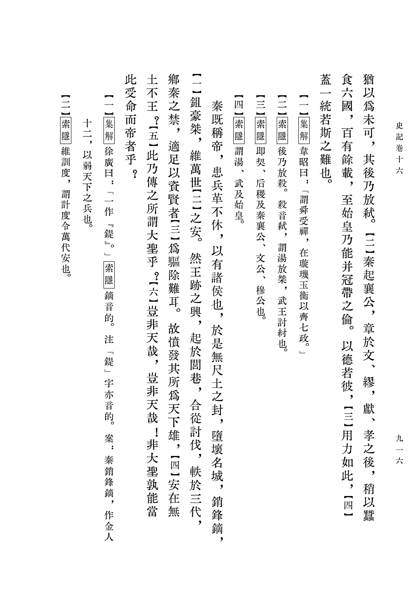

English | [中文版](Examples)

# Examples

This directory contains multiple usage examples for the `luatex-cn` package, demonstrating everything from traditional ancient book typesetting to modern vertical and horizontal layouts.

## Example List

### 1. Records of the Grand Historian - Basic Annals of the Five Emperors

**Features**: Demonstrates highly complex ancient book typesetting.

**Capabilities**:
- Absolutely positioned red seals (overlaying text)
- Customized page center text with single fishtail
- Complex interlinear note typesetting
- Traditional black silk frame and indentation

📂 [View Source](https://github.com/open-guji/luatex-cn/tree/main/示例/史记五帝本纪)

---

### 2. Annotated Catalogue of the Siku Quanshu - Table of Contents

**Features**: The Wenyuan Pavilion edition, in Qing Dynasty "Siku Quanshu" style.

**Capabilities**:
- Standard ancient book table of contents layout (`\条目[level]{...}`)
- "Eight lines, twenty-one characters" format restriction
- White mouth, double borders on all sides, single fishtail format
- Double-line small annotations (`\注{...}`) and an overlaid imperial seal (`\印章[page=1, opacity=0.7]{...}`)

📂 [View Source](https://github.com/open-guji/luatex-cn/tree/main/示例/四库全书简明目录) ｜ 📄 [View PDF](https://github.com/open-guji/luatex-cn/blob/main/示例/四库全书简明目录/目录.pdf)

> A full multi-volume reproduction lives in [全书复刻/欽定四庫全書簡明目錄](https://github.com/open-guji/luatex-cn/tree/main/全书复刻/欽定四庫全書簡明目錄).

---

### 3. Dream of the Red Chamber - Jiaxu Manuscript

**Features**: Simulates manuscript/annotated copy style.

**Capabilities**:
- **Side and marginal notes**: Edge annotations using the sidenote system
- **Double-column small text**: Double-line small annotations in main text
- No fishtail page center, bottom page numbers

| Page 2 (Punctuation) | Page 1 (Marginal Notes) |
| :---: | :---: |
|  |  |

📂 [View Source](https://github.com/open-guji/luatex-cn/tree/main/示例/红楼梦甲戌本)

---

### 4. Records of the Grand Historian, Vol. 16 - Modern Vertical

**Class**: `ltc-cn-vbook` | **Template**: `中华书局` (Zhonghua Shuju)

**Capabilities**:
- Modern punctuation squeeze (`\punctSetup{punct-squeeze=true}`)
- Kinsoku line-breaking rules (`\punctSetup{kinsoku=true}`)
- Footnotes (`\脚注{...}`) with lujiao numbering
- Paragraph indentation (`\begin{段落}[indent=2]`)
- Mainland punctuation style

| Page 1 | Page 2 |
| :---: | :---: |
|  |  |

📂 [View Source](https://github.com/open-guji/luatex-cn/tree/main/示例/史记卷十六·现代) ｜ 📄 [View PDF](https://github.com/open-guji/luatex-cn/blob/main/示例/史记卷十六·现代/卷十六.pdf)

---

### 5. 論辯的魂靈 by Lu Xun — Modern Horizontal (clreq)

**Setup**: `article` + the `luatex-cn-hori` package (not yet in a release — main branch).

The same essay set twice for comparison: the traditional-character part uses `style=taiwan` (centered punctuation), the simplified part uses `style=mainland` + `quote-style=curly` (corner quotes converted to curly, double outside and single inside).

**Capabilities**:
- CJK–Western spacing and basic-level kinsoku
- Consecutive-punctuation reduction (2 em → 1.5 em) and line-start/line-end compression
- Orphan-character avoidance at paragraph end
- `\horiSetup{last-line=right}` for the closing colophon
- Traditional size numbers via `\字号{二号}`

📂 [View Source](https://github.com/open-guji/luatex-cn/tree/main/示例/论辩的魂灵) ｜ 📄 [View PDF](https://github.com/open-guji/luatex-cn/blob/main/示例/论辩的魂灵/论辩的魂灵.pdf) ｜ 📖 [[Horizontal | EN:Horizontal]]

---

*Note: All ancient book examples are digital reconstructions based on historical document scans, intended to demonstrate `luatex-cn`'s adaptability to various complex vertical typesetting scenarios.*
