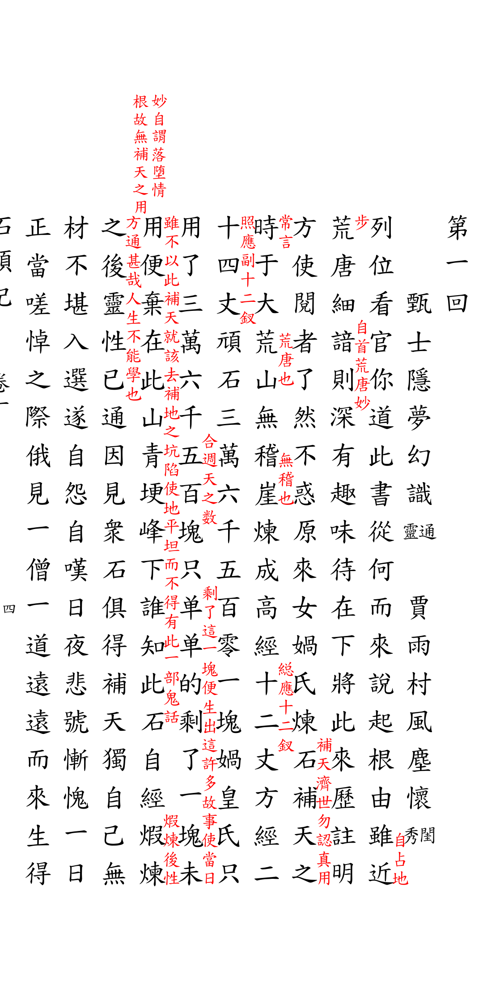

English | [中文版](Examples)

# Examples

This directory contains multiple usage examples for the `luatex-cn` package, demonstrating different features from traditional ancient book typesetting to modern vertical layouts.

## Example List

### 1. Records of the Grand Historian - Basic Annals of the Five Emperors

**Features**: Demonstrates highly complex ancient book typesetting.

**Capabilities**:
- Absolutely positioned red seals (overlaying text)
- Customized page center text with single fishtail
- Complex interlinear note typesetting
- Traditional black silk frame and indentation

| Black & White | Color Preview |
| :---: | :---: |
|  |  |

📂 [View Source](https://github.com/open-guji/luatex-cn/tree/main/示例/史记五帝本纪)

---

### 2. Records of the Grand Historian - Table of Contents

**Features**: Following Qing Dynasty "Siku Quanshu" Northern Pavilion style.

**Capabilities**:
- Standard ancient book table of contents layout
- "Eight lines, twenty-one characters" format restriction
- Typical white mouth, double borders on all sides, single fishtail format

📂 [View Source](https://github.com/open-guji/luatex-cn/tree/main/示例/史记目录)

---

### 3. Dream of the Red Chamber - Jiaxu Manuscript

**Features**: Simulates manuscript/annotated copy style.

**Capabilities**:
- **Side and marginal notes**: Edge annotations using the sidenote system
- **Double-column small text**: Double-line small annotations in main text
- No fishtail page center, bottom page numbers

| Page 2 (Punctuation) | Page 1 (Marginal Notes) |
| :---: | :---: |
|  |  |

📂 [View Source](https://github.com/open-guji/luatex-cn/tree/main/示例/红楼梦甲戌本)

---

### 4. Modern Vertical Book

**Features**: Clean modern vertical layout style.

**Capabilities**:
- Demonstrates pure vertical text support without traditional book elements
- Suitable for modern literature or reports requiring vertical typesetting

> 📌 Modern vertical books are not currently the project focus; more features will be added later.

📂 [View Source](https://github.com/open-guji/luatex-cn/tree/main/示例/现代竖排书)

---

*Note: All ancient book examples are digital reconstructions based on historical document scans, intended to demonstrate `luatex-cn`'s adaptability to various complex vertical typesetting scenarios.*
