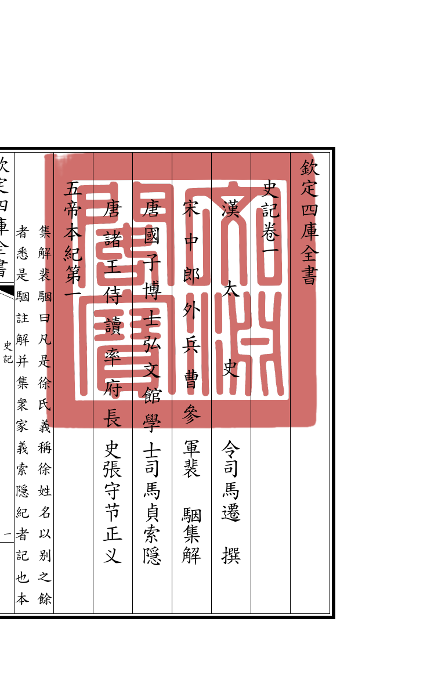
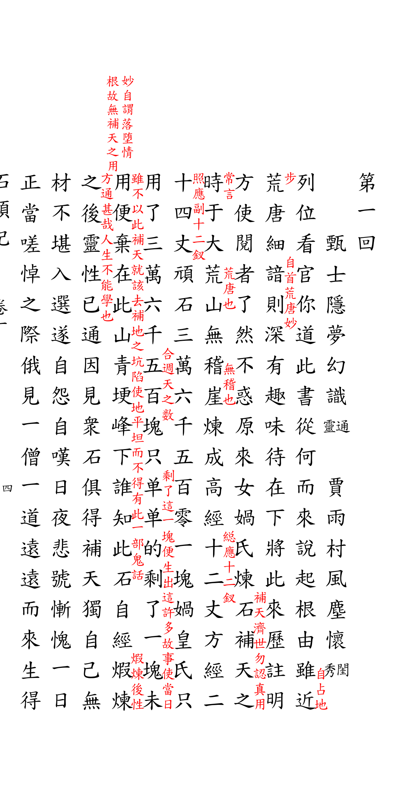
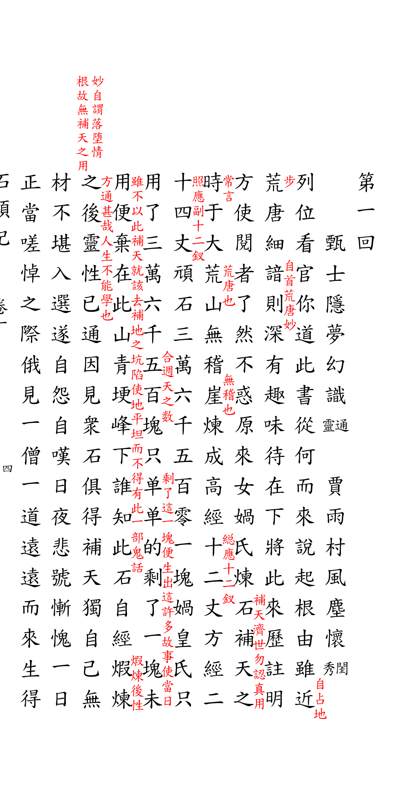

English | [中文版](Home)

# LuaTeX-CN

A LuaTeX package for Chinese character typesetting, covering horizontal/vertical, traditional/modern layout. Currently focused on Ancient Book replication with implemented core logic of vertical typesetting, decorative elements of traditional Chinese books, and interlinear notes.

> **Current Version**: [v0.2.2](https://github.com/open-guji/luatex-cn/releases) | **CTAN**: [v0.1.1](https://ctan.org/pkg/luatex-cn)

## Features

- **Vertical Typesetting**: Powerful core engine for classic vertical layouts
- **Traditional Book Format**: Complete support for "Banxin" (版心), "Yuwei" (鱼尾), and borders
- **Interlinear Notes**: Automatic balancing and column splitting for double-line small annotations
- **Side Notes**: Small-character annotations between columns with automatic column switching
- **Annotations**: Floating annotation boxes positioned anywhere on the page
- **Punctuation Marks**: Support for traditional Chinese punctuation (Judou)
- **Seals**: Absolute positioning for background images

## Showcase

### "Records of the Grand Historian" (Siku Quanshu Style)

Demonstrates complex annotations, single-fishtail page center, and absolutely positioned collection seals.

| Black & White | Color Preview |
| :---: | :---: |
|  |  |

### "Dream of the Red Chamber" (Jiaxu Manuscript)

Demonstrates side notes, marginal notes, punctuation marks, and manuscript-style layout.

| Page 2 (Punctuation) | Page 1 (Marginal Notes) |
| :---: | :---: |
|  |  |

## Roadmap

- ✅ Implemented: Vertical typesetting, page center, interlinear notes, side notes, seals, punctuation, correction & decoration
- ✅ v0.2.x: Plugin architecture refactoring, style registry, cross-page color preservation, metadata system
- 🔜 v0.3.0: Complete style stack architecture (Phase 3), full context nesting inheritance support
- 📋 Planned: Modern traditional vertical typesetting, improved CTAN release version

## Quick Start

👉 [[Installation | EN:Installation]] | [[Quick Start | EN:Quick-Start]] | [[Examples | EN:Examples]]

## Contact

- **Contact**: Sheldon Li
- **Email**: sheldonli.dev@gmail.com
