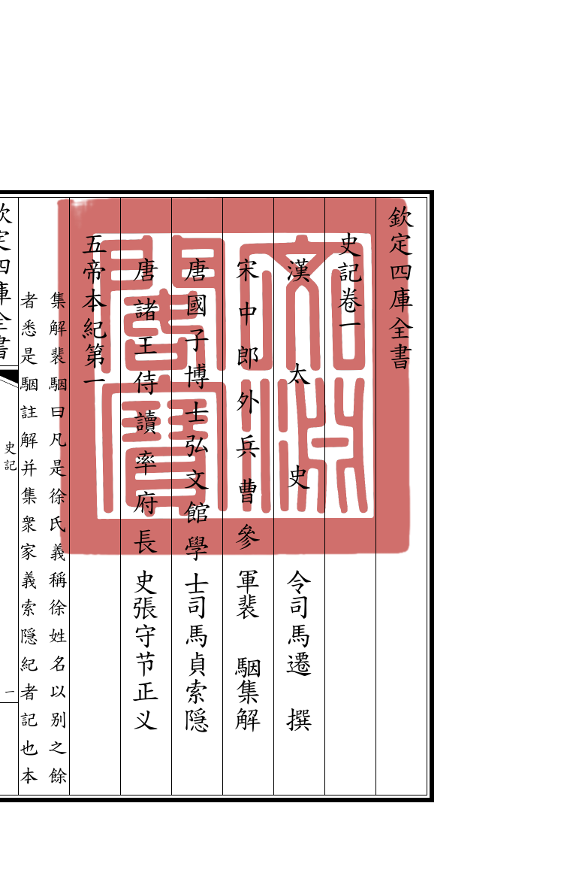
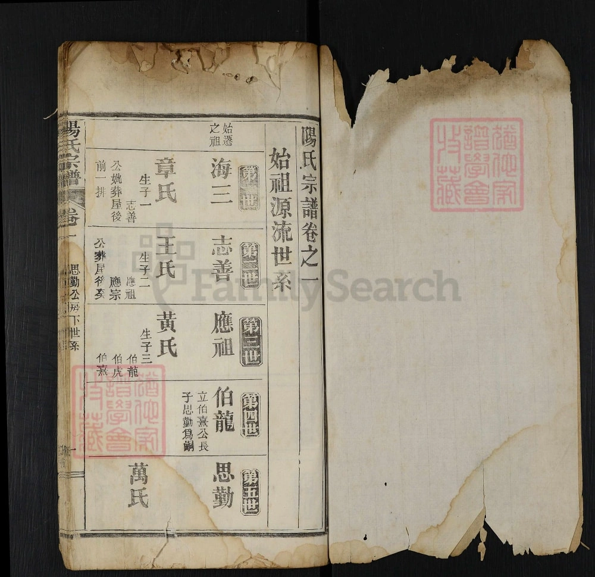

[English Version](EN:Examples) | 中文版

# 示例

以下示例展示了 `luatex-cn` 从传统古籍、现代竖排到现代横排的排版能力。每个示例都可以直接下载源码编译。

> 如果你还没跑通第一个示例，建议先看 [[快速入门 | Quick-Start]]。

---

## 1. 史记·五帝本纪 — 四库全书排版

**文档类**: `ltc-guji` | **模板**: `四库全书` / `四库全书彩色`



**演示功能**：
- 版心与单鱼尾（`\banxinSetup`）
- 复杂夹注（`\夹注{...}`）— 自动平衡、跨列跨页
- 印章绝对定位（`\印章[page=1]{...}`）
- 乌丝栏边框与排版缩进

📂 [查看源码](https://github.com/open-guji/luatex-cn/tree/main/示例/史记五帝本纪) ｜ 📄 [查看 PDF](https://github.com/open-guji/luatex-cn/blob/main/示例/史记五帝本纪/史记.pdf)

---

## 2. 钦定四库全书简明目录 — 文渊阁本目录页

**文档类**: `ltc-guji` | **模板**: `SiKuMuLu`（示例自带 `.cfg`）


**演示功能**：
- 标准古籍目录布局（`\条目[层级]{...}` 命令）
- "八行二十一字"的行款限制
- 白口、四周双边、单鱼尾版式
- 注文双行小字（`\注{...}`）与文渊阁宝印叠加（`\印章[page=1, opacity=0.7]{...}`）

📂 [查看源码](https://github.com/open-guji/luatex-cn/tree/main/示例/四库全书简明目录) ｜ 📄 [查看 PDF](https://github.com/open-guji/luatex-cn/blob/main/示例/四库全书简明目录/目录.pdf)

> 全书复刻版（多册）见 [全书复刻/欽定四庫全書簡明目錄](https://github.com/open-guji/luatex-cn/tree/main/全书复刻/欽定四庫全書簡明目錄)。

---

## 3. 红楼梦甲戌本 — 手抄批改本

**文档类**: `ltc-guji` | **模板**: `红楼梦甲戌本`

| 第二页（标点） | 第一页（眉批） |
| :---: | :---: |
|  |  |

**演示功能**：
- 侧批（`\侧批{...}`）— 行间红色批注
- 批注（`\批注{...}`）— 页面浮动批注框
- 夹注（`\夹注{...}`）— 双行小字
- 句读模式（`\开启句读模式`）— 传统句/读标记
- 无鱼尾版心，底部页号

> 眉批（`\眉批{...}`）不在本示例中，见下方 [全书复刻的《红楼梦》甲戌本](#全书复刻)。

📂 [查看源码](https://github.com/open-guji/luatex-cn/tree/main/示例/红楼梦甲戌本) ｜ 📄 [查看 PDF](https://github.com/open-guji/luatex-cn/blob/main/示例/红楼梦甲戌本/石头记.pdf)

---

## 4. 史记·秦楚之际月表 — 现代繁体竖排

**文档类**: `ltc-cn-vbook` | **模板**: `中华书局`

| 第一页 | 第二页 |
| :---: | :---: |
|  |  |

**演示功能**：
- 现代标点挤压（`\punctSetup{punct-squeeze=true}`）
- 禁则处理（`\punctSetup{kinsoku=true}`）
- 脚注系统（`\脚注{...}`）— 鹿角编号
- 段落缩进（`\begin{段落}[indent=2]`）
- 中国大陆标点风格

📂 [查看源码](https://github.com/open-guji/luatex-cn/tree/main/示例/史记卷十六·现代) ｜ 📄 [查看 PDF](https://github.com/open-guji/luatex-cn/blob/main/示例/史记卷十六·现代/卷十六.pdf)

---

## 5. 论辩的魂灵（鲁迅）— 现代横排（clreq）

**文档类**: `article` + `\usepackage{luatex-cn}`（v0.4.0 起）

同一篇文章的两种排法对照：繁体部分用 `style=taiwan`（标点居中），简体部分用 `style=mainland` + `quote-style=curly`（原文的直角引号自动转为弯引号，嵌套先双后单）。

**演示功能**：
- 中西间距与四级换行禁则（`kinsoku-level=basic`）
- 连续标点缩减（2 → 1.5 字宽）、行首行尾标点挤压
- 段末孤字避免（前行借字）
- 段末行对齐 `\horiSetup{last-line=right}`（文末落款）
- 号数字号 `\字号{二号}`

📂 [查看源码](https://github.com/open-guji/luatex-cn/tree/main/示例/论辩的魂灵) ｜ 📄 [查看 PDF](https://github.com/open-guji/luatex-cn/blob/main/示例/论辩的魂灵/论辩的魂灵.pdf) ｜ 📖 [[现代横排 | Horizontal]]

---

## 6. 工尺谱 — 昆曲曲谱

**文档类**: `ltc-guji` | **模板**: 默认（印本）与 `红楼梦甲戌本`（手写本）

两份复刻，对应两种底本形态：

| 印本《鹊桥仙·圣世呈符》 | 手写本《西厢记·佳期·临镜序》 |
| :---: | :---: |
|  |  |

**演示功能**：
- 工尺主字与音字（`\工尺{影}{\音[板]{尺}\音[眼]{工}}`）— 板眼标记以红色小圆点区分
- 宫调注（`\宫调{仙吕調}`）、调名注（`\调名注{一名廣寒秋}`）
- 句读字（`\句读字`）与句读模式配合曲词断句
- 收紧行款（`\contentSetup{n-char-per-col=12, n-column=8}`）以匹配印本密度

📂 [查看源码](https://github.com/open-guji/luatex-cn/tree/main/示例/工尺谱) ｜ 📄 [印本 PDF](https://github.com/open-guji/luatex-cn/blob/main/示例/工尺谱/圣世呈符.pdf) ｜ [手写本 PDF](https://github.com/open-guji/luatex-cn/blob/main/示例/工尺谱/西厢记佳期.pdf)

---

## 7. 阳氏宗谱 — 欧式（苏式）谱表

**文档类**: `ltc-guji` | **模板**: `欧式族谱`



复刻《陽氏宗譜》卷之一「始祖源流世系」首开印面：以世次横栏分格，每格右为讳名、左为配氏与葬向小注。

**演示功能**：
- **表格系统**（唯一的表格示例）：`\begin{表格}[分栏=6, 栏高度=43.2pt, 行填充=页]`、`\栏格式`、`\单元格`、`\换栏`
- 八角墨围反白（`\八角墨围反白[高度=3, 填充]{第一世}`）作世次标签
- 样式覆盖（`\样式[格高=28pt, 字号=28pt]{...}`）
- 免安装字体族（`\设置字体族{Jigmo}`）
- 调试开关（`\开启调试`，源码中注释保留）

📂 [查看源码](https://github.com/open-guji/luatex-cn/tree/main/示例/欧式族谱) ｜ 📄 [查看 PDF](https://github.com/open-guji/luatex-cn/blob/main/示例/欧式族谱/族谱.pdf)

---

## 全书复刻

`示例/` 下是单页或数页的功能演示；[`全书复刻/`](https://github.com/open-guji/luatex-cn/tree/main/全书复刻) 放的是成册的完整复刻项目，页数多、编译慢。

| 项目 | 文档类 | 进度 | 独有演示 |
|------|--------|------|----------|
| [欽定四庫全書簡明目錄](https://github.com/open-guji/luatex-cn/tree/main/全书复刻/欽定四庫全書簡明目錄) | `ltc-guji` + `ltc-guji-digital` | 第一册（共 10 册 20 卷） | **数字化模式**（`\双列{\右小列{…}\左小列{…}}`、`\缩进`、`\换页`）、完整抬头体系（`\单抬`/`\平抬`/`\挪抬`/`\相对抬头`）、`\文本框`、`\校对页` |
| [紅樓夢·甲戌本](https://github.com/open-guji/luatex-cn/tree/main/全书复刻/紅樓夢/甲戌本) | `ltc-guji` | 凡例 + 第一回 | **眉批**（`\眉批{...}`，35 处）、**改字**（`\改{...}`） |

同一部书的语义版（`tex/`）与数字化版（`ditigal_tex/`、`*-digital.tex`）并存，可直接对照两种录入方式的差异。

---

## 功能对照表

| 功能 | 在哪个示例里看 |
|------|----------------|
| 版心与鱼尾 | 史记五帝本纪、四库简明目录（各模板不同） |
| 夹注 `\夹注` | 史记五帝本纪、四库简明目录、红楼梦、欧式族谱 |
| 侧批 `\侧批` | 红楼梦甲戌本 |
| 批注 `\批注` | 红楼梦甲戌本 |
| 眉批 `\眉批` | 仅全书复刻《红楼梦》甲戌本 |
| 印章 `\印章` | 史记五帝本纪、四库简明目录 |
| 句读 | 红楼梦甲戌本、工尺谱 |
| 目录条目 `\条目` | 四库简明目录 |
| 抬头（单抬/平抬/挪抬/相对抬头） | 四库简明目录、全书复刻 |
| 文本框 `\填充文本框` / `\文本框` | 史记五帝本纪、全书复刻 |
| 表格 | 欧式族谱 |
| 工尺谱 | 工尺谱（两份） |
| 墨围 / 八角墨围反白 | 史记卷十六·现代、欧式族谱 |
| 样式 `\样式` | 欧式族谱、全书复刻 |
| 改字 `\改` | 仅全书复刻《红楼梦》甲戌本 |
| 现代标点与禁则 | 史记卷十六·现代 |
| 脚注 `\脚注` | 史记卷十六·现代 |
| 数字化双列 | 仅全书复刻《四库简明目录》 |
| 横排 clreq | 论辩的魂灵 |

> **示例未覆盖的功能**：`ltc-tw-vbook` 文档类、线标（`\线标`/`\专名号`/`\书名号`）、装饰与圈点（`\装饰`/`\圈点`/`\发圈`）、缺字、旁注（`\旁注`）、牌记与悬浮文本框、插图页与换半页、[[排版坐标导出 | Layout-Export]]，以及横排的行间标号／行间注／均排／段落排式（示例只用到 `\字号` 与 `\horiSetup`）。这些能力目前只在 `test/regression_test/` 的测试文档里有用例。

---

## 如何运行示例

1. 下载或克隆项目仓库
2. 进入示例目录，如 `示例/史记五帝本纪/`
3. 运行 `lualatex 史记.tex`
4. 打开生成的 PDF 查看效果

```bash
cd 示例/史记五帝本纪
lualatex 史记.tex
```

---

*所有古籍示例均基于历史文献扫描件进行数字重构，旨在展示 `luatex-cn` 对各种复杂竖排场景的适配能力。*
