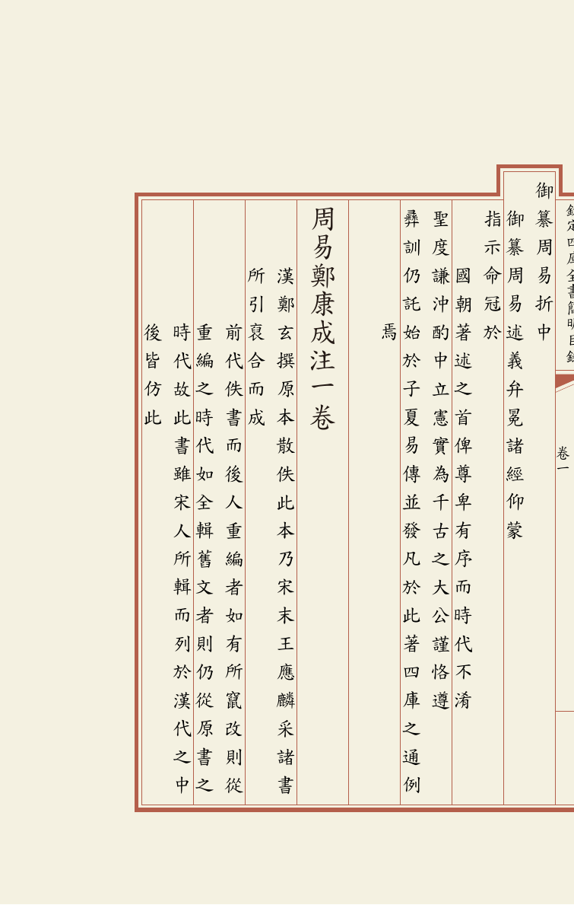
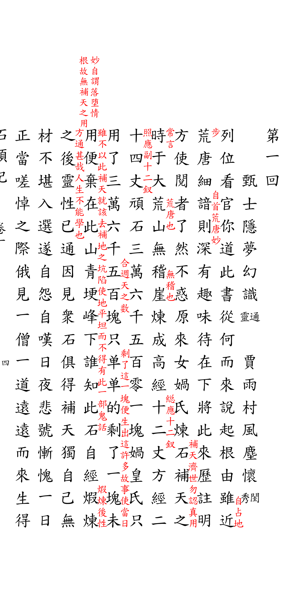
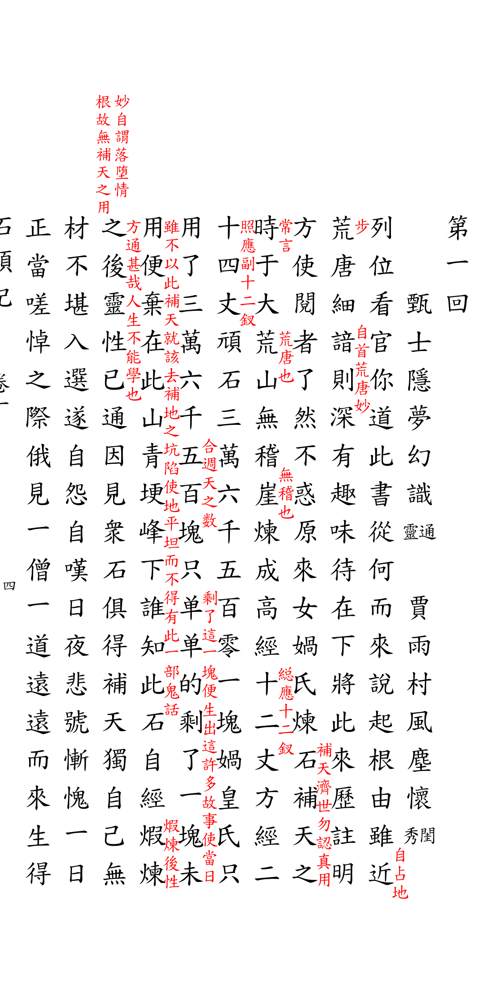
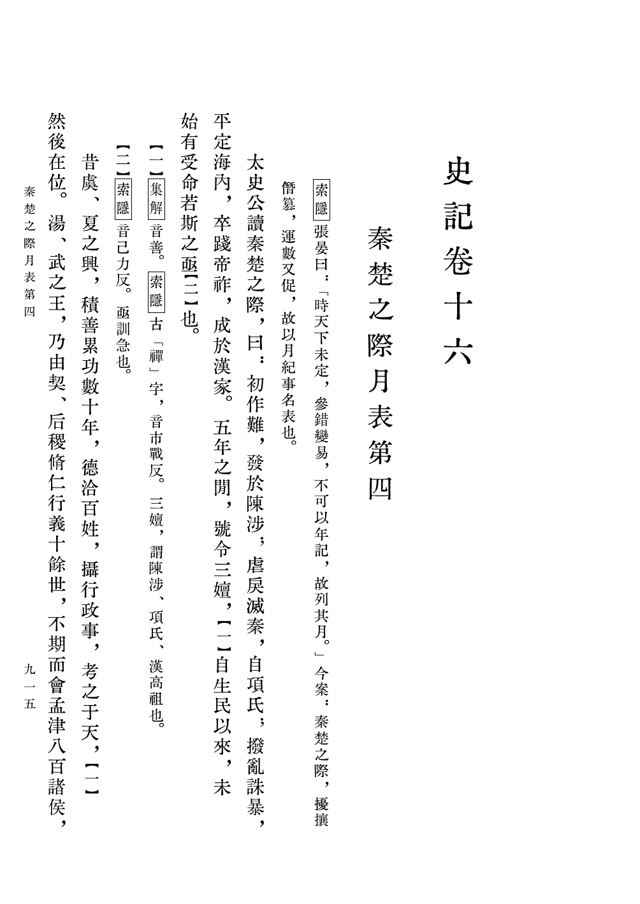
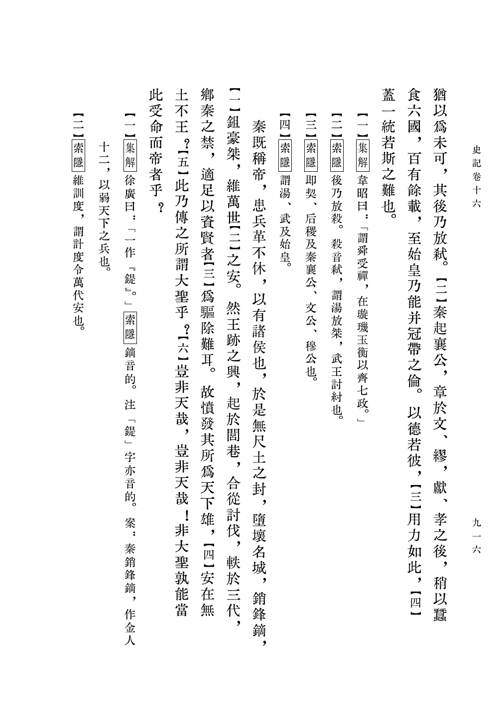

[English Version](EN:Examples) | 中文版

# 示例

以下示例展示了 `luatex-cn` 从传统古籍、现代竖排到现代横排的排版能力。每个示例都可以直接下载源码编译。

> 如果你还没跑通第一个示例，建议先看 [[快速入门 | Quick-Start]]。

---

## 1. 史记·五帝本纪 — 四库全书排版

**文档类**: `ltc-guji` | **模板**: `四库全书` / `四库全书彩色`


**演示功能**：
- 版心与单鱼尾（`\banxinSetup`）
- 复杂夹注（`\夹注{...}`）— 自动平衡、跨列跨页
- 印章绝对定位（`\印章[page=1]{...}`）
- 乌丝栏边框与排版缩进

📂 [查看源码](https://github.com/open-guji/luatex-cn/tree/main/示例/史记五帝本纪) ｜ 📄 [查看 PDF](https://github.com/open-guji/luatex-cn/blob/main/示例/史记五帝本纪/史记.pdf)

---

## 2. 钦定四库全书简明目录 — 文渊阁本目录页

**文档类**: `ltc-guji` | **模板**: `SiKuMuLu`（示例自带 `.cfg`）



**演示功能**：
- 标准古籍目录布局（`\条目[层级]{...}` 命令）
- "八行二十一字"的行款限制
- 白口、四周双边、单鱼尾版式
- 注文双行小字（`\注{...}`）与文渊阁宝印叠加（`\印章[page=1, opacity=0.7]{...}`）

📂 [查看源码](https://github.com/open-guji/luatex-cn/tree/main/示例/四库全书简明目录) ｜ 📄 [查看 PDF](https://github.com/open-guji/luatex-cn/blob/main/示例/四库全书简明目录/目录.pdf)

> 全书复刻版（多册）见 [全书复刻/欽定四庫全書簡明目錄](https://github.com/open-guji/luatex-cn/tree/main/全书复刻/欽定四庫全書簡明目錄)。

---

## 3. 红楼梦甲戌本 — 手抄批改本

**文档类**: `ltc-guji` | **模板**: `红楼梦甲戌本`

| 第二页（标点） | 第一页（眉批） |
| :---: | :---: |
|  |  |

**演示功能**：
- 侧批（`\侧批{...}`）— 行间红色批注
- 眉批（`\眉批{...}`）— 页面顶部批注，自动排列
- 夹注（`\夹注{...}`）— 双行小字
- 句读模式（`\句读模式`）— 传统句/读标记
- 无鱼尾版心，底部页号

📂 [查看源码](https://github.com/open-guji/luatex-cn/tree/main/示例/红楼梦甲戌本) ｜ 📄 [查看 PDF](https://github.com/open-guji/luatex-cn/blob/main/示例/红楼梦甲戌本/石头记.pdf)

---

## 4. 史记·秦楚之际月表 — 现代繁体竖排

**文档类**: `ltc-cn-vbook` | **模板**: `中华书局`

| 第一页 | 第二页 |
| :---: | :---: |
|  |  |

**演示功能**：
- 现代标点挤压（`\punctSetup{punct-squeeze=true}`）
- 禁则处理（`\punctSetup{kinsoku=true}`）
- 脚注系统（`\脚注{...}`）— 鹿角编号
- 段落缩进（`\begin{段落}[indent=2]`）
- 大陆标点风格

📂 [查看源码](https://github.com/open-guji/luatex-cn/tree/main/示例/史记卷十六·现代) ｜ 📄 [查看 PDF](https://github.com/open-guji/luatex-cn/blob/main/示例/史记卷十六·现代/卷十六.pdf)

---

## 5. 论辩的魂灵（鲁迅）— 现代横排（clreq）

**文档类**: `article` + `luatex-cn-hori` 宏包（尚未进入发行版，需 main 分支）

同一篇文章的两种排法对照：繁体部分用 `style=taiwan`（标点居中），简体部分用 `style=mainland` + `quote-style=curly`（原文的直角引号自动转为弯引号，嵌套先双后单）。

**演示功能**：
- 中西间距与四级换行禁则（`kinsoku-level=basic`）
- 连续标点缩减（2 → 1.5 字宽）、行首行尾标点挤压
- 段末孤字避免（前行借字）
- 段末行对齐 `\horiSetup{last-line=right}`（文末落款）
- 号数字号 `\字号{二号}`

📂 [查看源码](https://github.com/open-guji/luatex-cn/tree/main/示例/论辩的魂灵) ｜ 📄 [查看 PDF](https://github.com/open-guji/luatex-cn/blob/main/示例/论辩的魂灵/论辩的魂灵.pdf) ｜ 📖 [[现代横排 | Horizontal]]

---

## 功能对照表

| 功能 | 史记五帝本纪 | 四库简明目录 | 红楼梦甲戌本 | 现代竖排 |
|------|:-----------:|:-------:|:-----------:|:-------:|
| 版心/鱼尾 | ✅ | ✅ | ✅(无鱼尾) | — |
| 夹注 | ✅ | ✅ | ✅ | — |
| 侧批 | — | — | ✅ | — |
| 眉批 | — | — | ✅ | — |
| 印章 | ✅ | ✅ | — | — |
| 句读 | — | — | ✅ | — |
| 现代标点 | — | — | — | ✅ |
| 脚注 | — | — | — | ✅ |
| 目录条目 | — | ✅ | — | — |

> 上表列的是竖排版式功能。横排示例《论辩的魂灵》用的是另一套能力（中西间距、行内挤压／拉伸、引号体例转换等），见 [[现代横排 | Horizontal]]。

---

## 如何运行示例

1. 下载或克隆项目仓库
2. 进入示例目录，如 `示例/史记五帝本纪/`
3. 运行 `lualatex 史记.tex`
4. 打开生成的 PDF 查看效果

```bash
cd 示例/史记五帝本纪
lualatex 史记.tex
```

---

*所有古籍示例均基于历史文献扫描件进行数字重构，旨在展示 `luatex-cn` 对各种复杂竖排场景的适配能力。*
