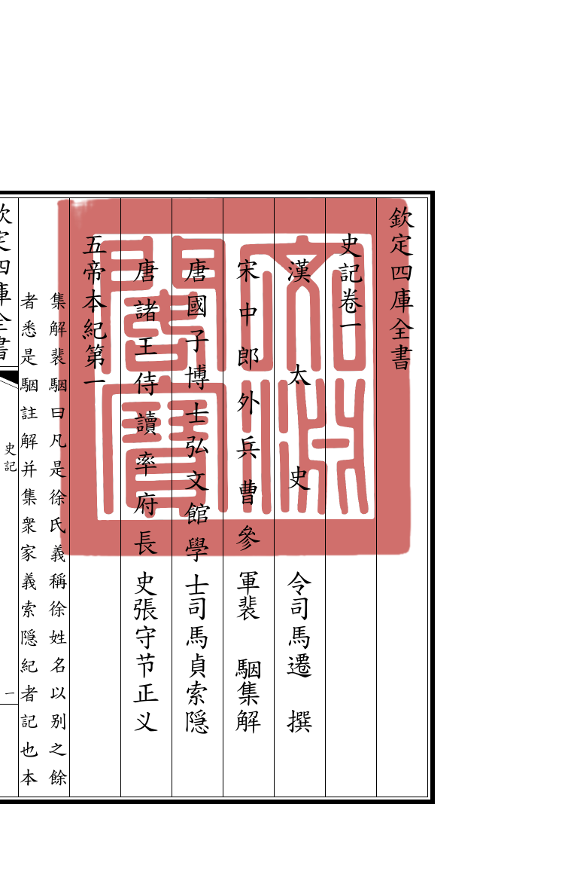
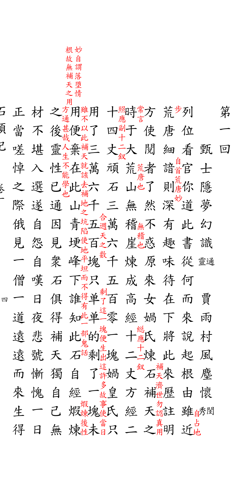
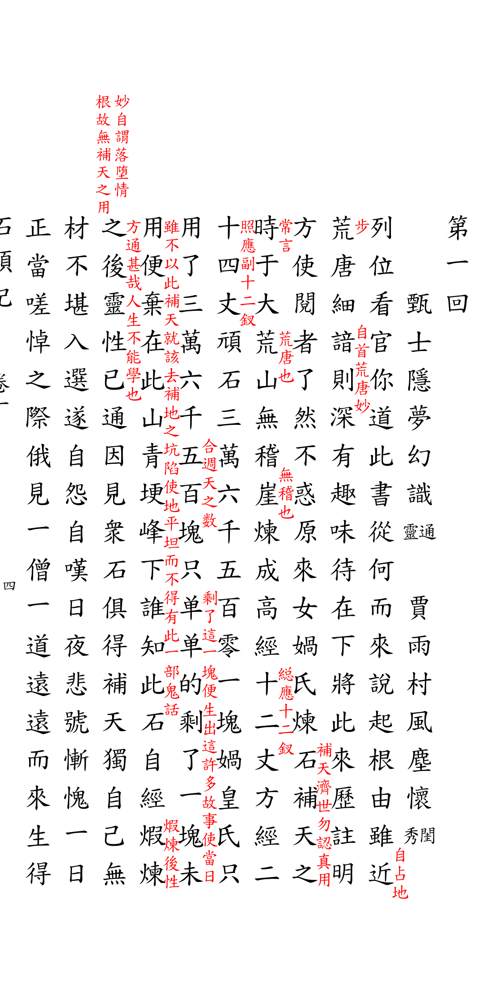

[English Version](EN:Home) | 中文版

# LuaTeX-CN

致力于基于 LuaTeX 引擎实现最纯粹、最高质量的中文排版支持。长期愿景希望完整支持中文排版，包括横排/竖排，古籍/现代版式。目前主要实现古籍复刻，已完整覆盖竖排核心逻辑、版心装饰及夹注处理。

> **当前版本**: [v0.2.5](https://github.com/open-guji/luatex-cn/releases) | **CTAN**: [v0.1.1](https://ctan.org/pkg/luatex-cn)

## 功能特性

- **竖排排版**：经典竖排布局的强大核心引擎
- **古籍版式**：完整支持"版心"、"鱼尾"和边框
- **夹注**：双栏小注的自动平衡和分列
- **侧批**：两列中间小字批注，自动换列
- **批注**：支持在页面任意位置浮动定位的批注框
- **句读**：古籍标点符号支持
- **印章**：绝对定位添加背景图

## 展示

### 《史记·五帝本纪》 (四库全书排版)

演示了复杂的加注、单鱼尾版心以及馆藏印章的绝对定位。

| 黑白仿真 | 彩色预览 |
| :---: | :---: |
|  |  |

### 《红楼梦》（甲戌本排版）

演示了侧批、眉批、标点、手抄本版式。

| 第二页（标点） | 第一页（眉批） |
| :---: | :---: |
|  |  |

## 路线图

- ✅ 已实现：古籍竖排，版心，夹注，侧批，印章，句读，改字与装饰
- ✅ v0.2.x：插件架构重构，样式注册表，颜色跨页保持，元数据系统
- 🔜 v0.3.0：完善样式栈架构（Phase 3），支持完整的上下文嵌套继承
- 📋 计划中：实现现代繁体竖排，完善 CTAN 发布版本

## 快速开始

👉 [[安装指南 | Installation]] | [[快速入门 | Quick-Start]] | [[示例 | Examples]]

## 联系方式

- **联系人**: Sheldon Li
- **邮件**: sheldonli.dev@gmail.com
